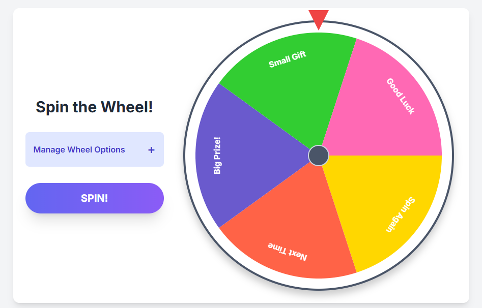

# Spin the Wheel

A dynamic, customizable spin wheel web app for raffles, giveaways, classroom activities, and more. Built with vanilla JavaScript, HTML5 Canvas, and styled with Tailwind CSS for a modern, responsive UI.

## Features

- **Interactive High-DPI Wheel:** Razor-sharp Retina canvas wheel with radial depth shading, 3D concentric metallic hub, and dual-tone outer bezel.
- **Visible Striker Pegs & Ticker SFX:** Physical 3D metallic chrome studs at every slice boundary that visibly strike against the needle with mechanical tick audio.
- **Sound Control & Victory Fanfare:** Built-in mute/unmute toggle (persisted in `localStorage`) and a synthesized 4-note celebratory arpeggio chime on win.
- **Fullscreen Confetti Burst:** Zero-dependency canvas confetti shower celebrating every win.
- **Winning Slice Highlight:** Flashes a glowing highlight pulse over the winning segment upon landing.
- **Custom Options & Weights:** Add, remove, edit, and assign custom weights to up to 16 options dynamically with color-coded segment indicators.
- **Quick Utilities:** One-click option shuffle to randomize slice order and one-click reset to defaults.
- **Clean SVG Iconography:** Pure inline SVG icons throughout the interface with zero emoji dependencies.
- **Responsive & Accessible:** Works seamlessly on desktop and mobile devices with keyboard shortcuts (`Enter`, `Escape`) and focus management.
- **Zero Dependencies:** Pure HTML5, CSS3, and vanilla JavaScript (Tailwind via CDN).

## Demo



## Getting Started

### 1. Clone or Download

```bash
git clone https://github.com/AadityaGeek/spin-the-wheel.git
cd spin-the-wheel
```

Or simply download and extract the ZIP.

### 2. Open in Browser

Just open `index.html` in your favorite browser. No build step required.

## Usage

1. **Add Options:**  
   Enter an option name in the input and click "Add" (or press Enter). Up to 16 options are supported.

2. **Edit Options & Weights:**  
   Click the pencil icon next to an option to edit its label and custom weight in place, then click the checkmark (or press Enter) to save.

3. **Remove Options:**  
   Click the trash icon next to an option to remove it from the wheel.

4. **Spin the Wheel:**  
   Click "SPIN THE WHEEL!". The wheel animates smoothly and stops on the winning option based on your weighted probabilities.

5. **View Result:**  
   The winning option is highlighted in a celebratory popup modal. Click "Awesome!" or press Escape to dismiss.

## Customization

- **Colors:**  
  Edit the `colors` array in `script.js` to change segment colors.
- **Styling:**  
  Modify `style.css` or extend Tailwind classes in `index.html` for further customization.

## File Structure

```bash
spin-the-wheel/
├── index.html # Main HTML file
├── style.css # Custom styles
├── script.js # Wheel logic and interactivity
├── README.md # Project documentation
└── spin-the-wheel.png # Demo screenshot
```

## Accessibility & Responsiveness

- Fully keyboard accessible (tab to input, enter to add, etc.)
- Responsive layout adapts to all screen sizes.

## License

MIT License.  
Feel free to use, modify, and share!

## Credits

- [Tailwind CSS](https://tailwindcss.com/) for utility-first styling.
- [Google Fonts - Inter](https://fonts.google.com/specimen/Inter) for typography.

---

*Created by [Aaditya Kumar](https://github.com/AadityaGeek). Contributions welcome!*
